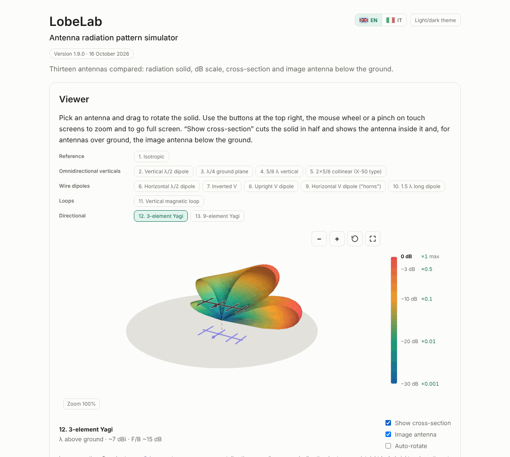

# LobeLab

**Interactive 3D radiation pattern simulator for common ham radio antennas.**
Educational, runs offline in a single HTML file.

*Simulatore didattico di diagrammi di radiazione* · [English](#english) · [Italiano](#italiano)

**▶ Open LobeLab: https://bberry2020.github.io/lobelab/**

> ⚠️ **Educational use only.** The patterns come from simplified theoretical models. Do not use them to design, verify or certify a real installation, or for regulatory or EMF exposure assessments.

---

## English

### What it is
LobeLab shows the 3D radiation pattern of 13 antennas, from the isotropic reference to a 9-element Yagi. Rotate the solid, zoom in, cut it in half to see the antenna inside, and see how the ground "mirrors" horizontal antennas through the image antenna.

The interface is available in **English** (default) and **Italian**: use the flag buttons at the top right, or open the page with `?lang=it`.

### Antennas

| Group | Antennas |
|---|---|
| Reference | 1. Isotropic |
| Omnidirectional verticals | 2. Vertical λ/2 dipole · 3. λ/4 ground plane · 4. 5/8 λ vertical · 5. 2×5/8 collinear |
| Wire dipoles | 6. Horizontal λ/2 dipole · 7. Inverted V · 8. Upright V dipole ("V cornuta") · 9. Horizontal V dipole ("corna") · 10. 1.5 λ long dipole |
| Loops | 11. Vertical magnetic loop |
| Directional | 12. 3-element Yagi · 13. 9-element Yagi |

### Features
- 3D solid you can rotate, with a colour scale in dB relative to the maximum and the matching power multiplier (×1, ×0.5, ×0.1, ×0.01, ×0.001).
- **Absolute scale (dBi)**: one common scale for all antennas, compared with the isotropic antenna, so you can see how much a Yagi really stands out.
- **History and background** for every antenna, with a link to Wikipedia for further reading.
- **Save image**: exports the current view as a PNG, with antenna name, colour scale and credits.
- **Section view**: cuts the solid in half and shows the antenna, the current direction and the feed point.
- **Image antenna** below the ground for antennas modelled over ground.
- Zoom and full screen; antenna menu and view toggles in full screen.
- Works on desktop, tablet and phone; dark theme by default, light theme one click away.
- English and Italian interface, with the choice remembered between visits.
- A single self-contained file: no installation, no internet connection needed.

### Controls

| Action | Mouse / touch | Keyboard |
|---|---|---|
| Rotate | drag | — |
| Zoom | wheel, pinch, **+** **−** buttons | `+` `−` |
| Reset view | ↺ button | `0` |
| Full screen | ⛶ button | `F` (`Esc` to exit) |
| Save image (PNG) | ⤓ button | `S` |

### Use it offline
Download `index.html` from this repository or from the [latest release](https://github.com/BBerry2020/lobelab/releases/latest) and open it in any modern browser.

### How the models work
Patterns are computed in the browser from textbook formulas. Inverted V, upright V and horizontal V dipoles are computed by summing short wire segments with a sinusoidal current. Ground is modelled as a perfect conductor using the image antenna. Gains are indicative; real ground, nearby objects and feed lines change the real pattern. In the absolute (dBi) scale each solid is scaled to an indicative peak gain (over ground where applicable), while its shape comes from the model.

### Privacy
LobeLab uses **no cookies and no tracking**, and makes no network requests. It only stores your language and theme in your browser's local storage (`lobelab.lang`, `lobelab.theme`); you can clear them from your browser's site data settings.

### Acknowledgements
Many thanks to [A.R.I. – Associazione Radioamatori Italiani](https://www.ari.it/), and in particular to all the teachers of the **Corso Nazionale Aspiranti Radioamatori 2026**.

*LobeLab is an independent project and is not affiliated with or endorsed by A.R.I.*

### License
© 2026 [BBerry2020](https://github.com/BBerry2020) — LobeLab is released under the [Creative Commons Attribution-ShareAlike 4.0 International](https://creativecommons.org/licenses/by-sa/4.0/) license (CC BY-SA 4.0). You may share and adapt it, also commercially, if you give credit and release your changes under the same license.

Suggested attribution: *"LobeLab" by BBerry2020 (https://github.com/BBerry2020/lobelab), CC BY-SA 4.0.*

The embedded [three.js](https://threejs.org/) library (r186) is © 2010-2026 three.js authors, MIT License. See [THIRD-PARTY-NOTICES.md](THIRD-PARTY-NOTICES.md).

---

## Italiano

### Che cos'è
LobeLab mostra il solido di radiazione in 3D di 13 antenne, dall'isotropica di riferimento alla Yagi 9 elementi. Puoi ruotare il solido, fare lo zoom, tagliarlo a metà per vedere l'antenna all'interno e osservare come il suolo "specchia" le antenne orizzontali attraverso l'antenna immagine.

### Antenne

| Gruppo | Antenne |
|---|---|
| Riferimento | 1. Isotropica |
| Verticali omnidirezionali | 2. Dipolo λ/2 verticale · 3. Ground plane λ/4 · 4. Verticale 5/8 λ · 5. Collineare 2×5/8 |
| Dipoli filari | 6. Dipolo λ/2 orizzontale · 7. V rovesciata · 8. Dipolo a V cornuta · 9. Corna (dipolo a V orizzontale) · 10. Dipolo lungo 1,5 λ |
| Spire | 11. Loop magnetico verticale |
| Direttive | 12. Yagi 3 elementi · 13. Yagi 9 elementi |

### Funzioni
- Solido 3D ruotabile, con scala colori in dB relativi al massimo e moltiplicatore di potenza (×1, ×0,5, ×0,1, ×0,01, ×0,001).
- **Scala assoluta (dBi)**: una sola scala per tutte le antenne, riferita all'isotropica, per vedere quanto una Yagi sporge davvero.
- **Storia e approfondimenti** per ogni antenna, con il link a Wikipedia per saperne di più.
- **Salva immagine**: esporta la vista corrente in PNG, con nome dell'antenna, scala colori e crediti.
- **Vista in sezione**: taglia il solido a metà e mostra l'antenna, il verso della corrente e il punto di alimentazione.
- **Antenna immagine** sotto il suolo per le antenne modellate sopra il terreno.
- Zoom e schermo intero; a schermo intero, menu delle antenne e interruttori di visualizzazione.
- Funziona su computer, tablet e telefono; tema scuro di default, tema chiaro con un clic.
- Interfaccia in inglese e in italiano: bandierine in alto a destra, oppure apri la pagina con `?lang=it`. La scelta viene ricordata.
- Un solo file autonomo: niente installazione, nessuna connessione a internet richiesta.

### Comandi

| Azione | Mouse / touch | Tastiera |
|---|---|---|
| Ruotare | trascina | — |
| Zoom | rotella, pizzico, pulsanti **+** **−** | `+` `−` |
| Ripristina vista | pulsante ↺ | `0` |
| Schermo intero | pulsante ⛶ | `F` (`Esc` per uscire) |
| Salva immagine (PNG) | pulsante ⤓ | `S` |

### Uso offline
Scarica `index.html` da questo repository o dall'[ultima release](https://github.com/BBerry2020/lobelab/releases/latest) e aprilo con un browser moderno.

### Come funzionano i modelli
I diagrammi sono calcolati nel browser con le formule classiche. V rovesciata, V cornuta e corna sono calcolate sommando brevi tratti di filo con corrente sinusoidale. Il suolo è un conduttore perfetto, modellato con l'antenna immagine. I guadagni sono indicativi: terreno reale, oggetti vicini e linea di alimentazione cambiano il diagramma vero. Nella scala assoluta (dBi) ogni solido è scalato su un guadagno di picco indicativo (sopra il suolo dove previsto), mentre la forma è quella del modello.

> ⚠️ **Avvertenza.** Le simulazioni hanno finalità esclusivamente didattiche. I valori non vanno usati per progettare, dimensionare, verificare o certificare un impianto reale, né per valutazioni di conformità o di esposizione ai campi elettromagnetici.

### Privacy
LobeLab **non usa cookie né sistemi di tracciamento** e non fa richieste di rete. Ricorda solo lingua e tema nella memoria locale del browser (`lobelab.lang`, `lobelab.theme`); si possono cancellare dalle impostazioni del browser, tra i dati dei siti.

### Ringraziamenti
Un grazie sentito ad [A.R.I. – Associazione Radioamatori Italiani](https://www.ari.it/) e in particolare a tutti i docenti del **Corso Nazionale Aspiranti Radioamatori 2026**.

*LobeLab è un progetto indipendente, non affiliato ad A.R.I. né da essa approvato.*

### Licenza
© 2026 [BBerry2020](https://github.com/BBerry2020) — LobeLab è distribuito con licenza [Creative Commons Attribuzione - Condividi allo stesso modo 4.0 Internazionale](https://creativecommons.org/licenses/by-sa/4.0/deed.it) (CC BY-SA 4.0). Puoi condividerlo e modificarlo, anche a fini commerciali, citando l'autore e distribuendo le modifiche con la stessa licenza.

Attribuzione suggerita: *"LobeLab" di BBerry2020 (https://github.com/BBerry2020/lobelab), licenza CC BY-SA 4.0.*

La libreria [three.js](https://threejs.org/) incorporata (r186) è © 2010-2026 three.js authors, licenza MIT. Vedi [THIRD-PARTY-NOTICES.md](THIRD-PARTY-NOTICES.md).
